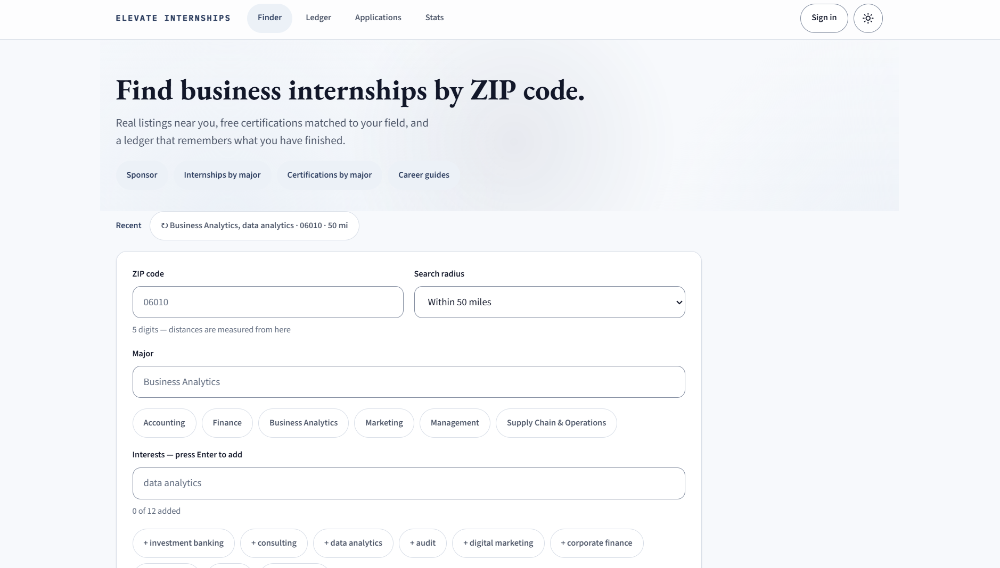
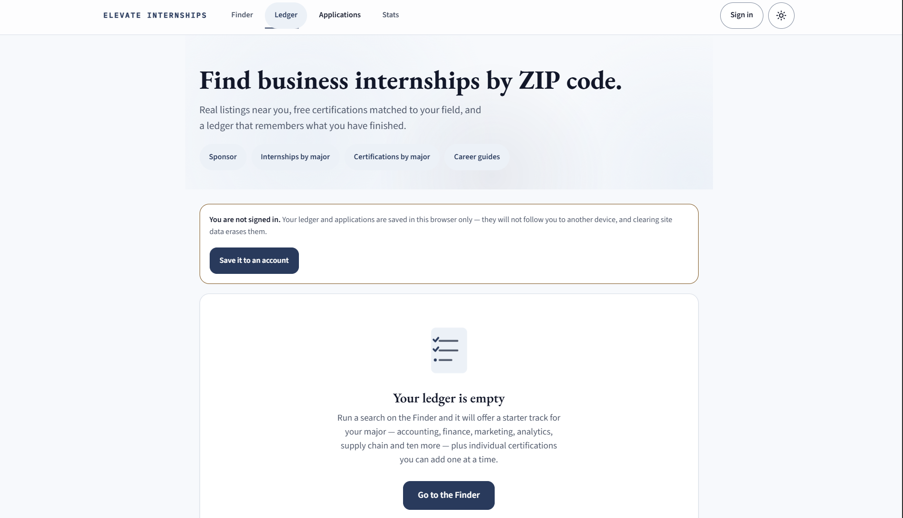

# Elevate Internships (Career Launchpad)

**Live site:** [elevateinternships.com](https://elevateinternships.com)

A free web app that helps business students find real internships near them and figure out which certifications are actually worth their time.

## Why I Built This

As a business student, I found that searching for internships meant jumping between a dozen job boards, and it was hard to tell which certifications employers cared about or which ones were really free. I built this to put both in one place so students can see real opportunities and a clear path to qualify for them.

## What It Does

- **Finder:** Enter a ZIP code and a radius to see real internship listings near you, filtered by season and remote or in person, and sorted by match, date, or distance. It also recommends certifications matched to your major and shows when that major usually recruits.
- **Ledger:** Track the certifications you have started and finished and what they cost. A finished certification can be added to LinkedIn in one click.
- **Applications:** Save internships and move them from Saved to Applied to Interviewing to Offer, with notes along the way.
- **Stats:** See your own progress over time.
- **Major pages:** One page for each of 23 business majors with its full certification list and recruiting timeline.
- **Browser extension:** "Save to Elevate Internships" pulls the job title, company, and location from any job posting and adds it to your tracker.
- **Installable app:** The site can be installed on a phone or computer like a regular app.

### By the numbers

- 23 business majors covered
- 222 certifications, each honestly labeled as free, free to audit, free through your campus, or paid
- Listings pulled from about 150 employers' own job boards plus 7 other internship sources

## Screenshots

**Finder:** search by ZIP code, radius, major, and interests



**Ledger:** track the certifications you start and finish



## Built With

**Frontend**
- React 18
- Vite
- Tailwind CSS
- Progressive web app (service worker and web manifest so it installs like an app)

**Backend**
- Node.js and Express
- SQLite (better-sqlite3) for accounts and saved data
- Web Push for notifications
- Google sign-in and email delivery through Resend or SMTP

**Data sources**
- Employer job boards on Greenhouse, Lever, Ashby, and SmartRecruiters
- Simplify, Himalayas, The Muse, Remotive, Jobicy, Adzuna, and USAJOBS
- US ZIP and city data from GeoNames for distance filtering

**Hosting and tooling**
- Render, with daily backups kept in Cloudflare Workers KV
- Docker for running it on other hosts
- GitHub Actions to check that every certification link still works
- Manifest V3 browser extension for Edge, Chrome, and Firefox
- Built with Claude Code as my AI coding assistant

## Running It Locally

Requires Node 20 or newer.

```bash
git clone https://github.com/xkalanquin-wq/elevate-internships.git
cd elevate-internships
npm install
npm run dev
```

This starts the API on port 3001 and the site on port 5173. It works with no API keys at all; Adzuna and USAJOBS are the only sources that need one. Copy `.env.example` to `.env` to add keys.

Full technical documentation (deployment, data sources, security, accessibility, and more) is in [TECHNICAL.md](TECHNICAL.md).

## What I Learned

- Taking a product from an idea to a live site on its own domain
- Pulling and cleaning data from many different sources into one consistent format
- Designing for a specific audience and what they actually need
- Working with an AI coding assistant to build faster while still reviewing and understanding the code myself

## What's Next

We are looking to partner with college career resource centers so students can get to the site through their own school, and so career advisors have a tool they can point students to. We also want Elevate Internships to run as an app on every platform, including iOS, Android, and desktop. Finally, we plan to expand beyond business majors, adding internships and certifications for students in every field of study.

## Author

**Xavier Kalanquin**
Business Analytics (BS) student, University of New Haven
[LinkedIn](https://linkedin.com/in/Xavier-Kalanquin)
